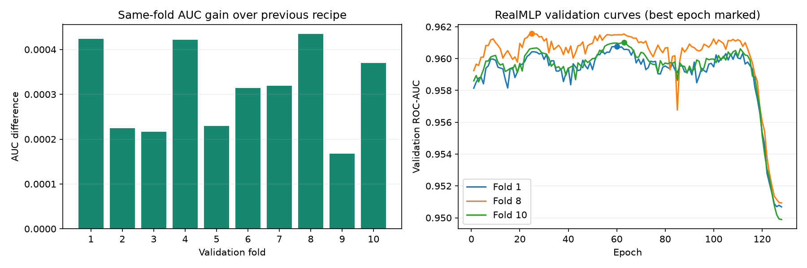

# 本轮优化实测报告

本轮目标是争取 Kaggle ROC-AUC 0.962。已完成最终方案的 10 折训练和预测核验。用户反馈最新提交成绩为 0.96074；成绩来自用户，未通过 Kaggle 接口独立核实。

## 实际结果

| 指标 | 旧方案 | 新方案 |
|---|---:|---:|
| 全部折外预测 OOF AUC | 0.961111828 | 0.961422659 |
| 10 折平均 AUC | 0.961119427 | 0.961431537 |
| 固定方案后的复核 AUC | 0.960868329 | 0.961248417 |
| Kaggle 提交 AUC | 0.96036（用户反馈） | 0.96074（用户反馈） |

OOF 变化：+0.000310831；相同 10 折中 10 折提高。新方案折间标准差 0.000629709。

本地 OOF **未达到 0.962**。本地 AUC 和线上 AUC 是两个结果，不能把本地分数直接当作线上成绩，也不能假设两者差值固定。

用户反馈的线上增益为 **+0.00038**，距离 0.962 仍差 **0.00126**。本地 OOF 与线上差值为 0.000682659，旧方案为 0.000751828。本轮增益体现在线上结果中，但两次提交不足以建立固定的本地到线上换算关系，也不能证明没有过拟合。反馈按最近交付的 submission_v3.csv 记录；用户未提供提交编号或文件名。

## 最终方法

新版本采用 66 个输入特征：21 个原始特征、21 个飞行距离分组统计、4 个频次统计、6 个折内目标编码、1 个原始数据模型的概率对数比、13 个服务评分辅助预测。

- 飞行距离分组统计只在当前训练分区学习，表示相同距离旅客的年龄、评分、客群组成与样本数；没有使用满意度标签。验证及测试只查询训练分区统计。
- 6 个目标编码键为飞行距离、年龄、飞行距离×年龄、飞行距离×舱位、飞行距离×出行目的、年龄×舱位×出行目的×客户类型。训练特征使用内部 5 折编码，验证及测试只用训练标签建立的映射。
- 原始数据模型沿用先前公开航空满意度数据训练的 XGBoost 先验。原始数据与比赛特征完全重合的 21 行已删除，保留 129859 行。
- 对每个服务评分，另用公开原始数据的其他 20 个共同特征训练一个回归器，预测期望评分。预测自身评分时排除该评分列；这些辅助回归器不使用满意度标签。
- 主模型候选为 XGBoost 和官方 RealMLP。数值填补、类别映射和所有训练型统计均按当前训练分区拟合。

最终固定权重：旧融合方案 40%、新 XGBoost 40%、RealMLP 20%。旧方案内部为 25% XGBoost 和 75% CatBoost，故最终 XGBoost 总权重 50%、CatBoost 权重 30%。

## 筛选与失败实验

所有候选使用此前相同的 447766 行拟合集、111942 行筛选集。旧融合方案筛选 AUC 0.960270327，最终新融合 0.960548912。

| 候选 | 筛选 AUC |
|---|---:|
| 旧 XGBoost（目标编码、原始数据统计及先验） | 0.959762207 |
| 新 XGBoost（66 特征） | 0.960318078 |
| 新 RealMLP（同样的 66 特征） | 0.959918344 |
| 参数调整后的最佳 CatBoost | 0.960301261 |
| TabM：完整统计输入 | 0.959065739 |
| TabM：简化输入、加宽网络 | 0.958069605 |

新 XGBoost 的输入和参数同时变化，因此不能把它与旧 XGBoost 的全部差值都归因于某一个特征。单独新增原始数据 CatBoost 先验未取得收益。7 个 CatBoost 参数候选的最佳融合筛选 AUC 为 0.960328966，但固定轮数复核较同次旧方案低约 0.000015；该分支仅保留了 2 折对照缓存，没有把它称为完整 10 折结果。

本轮没有继续添加随机插值合成样本：此前它降低了验证成绩。额外信息来自公开原始样本训练的先验和辅助特征。

## 验证边界与过拟合

最终权重先在有限固定网格选择，然后冻结。复核阶段不根据复核标签调整权重；XGBoost 按筛选最优轮数的 1.1 倍训练，RealMLP 只在开发数据内部留出 5% 选模型，不使用复核标签早停。

复核集上一轮已经看过，并非全新的独立测试集。本轮也在相同筛选集比较了多个方案；最终 10 折和筛选数据存在重叠，且折模型会用本折验证标签选择最佳轮次。这些因素可能使本地估计偏乐观。复核阶段的 RealMLP 内部 5% 划分发生在开发集目标编码之后，内部早停指标也可能偏乐观，但外层复核标签始终未进入编码或训练。不能仅凭训练 AUC 高于验证 AUC 就判定线上差距全部来自过拟合。

| 折 | 旧 AUC | 新 AUC | 变化 |
|---|---:|---:|---:|
| 1 | 0.9610940 | 0.9615173 | +0.0004233 |
| 2 | 0.9612337 | 0.9614577 | +0.0002240 |
| 3 | 0.9598477 | 0.9600642 | +0.0002165 |
| 4 | 0.9605700 | 0.9609922 | +0.0004222 |
| 5 | 0.9617789 | 0.9620079 | +0.0002290 |
| 6 | 0.9620782 | 0.9623926 | +0.0003145 |
| 7 | 0.9606580 | 0.9609776 | +0.0003196 |
| 8 | 0.9616536 | 0.9620880 | +0.0004344 |
| 9 | 0.9612596 | 0.9614273 | +0.0001677 |
| 10 | 0.9610205 | 0.9613905 | +0.0003700 |

曲线圆点标记最佳验证轮次。后期分数下降的轮次不作为最终模型；这说明轮次选择有作用，但不能单独证明线上差距来自哪一种原因。

## 交付与复现

- `submission_v3.csv`：可提交预测，共 299844 行，列为 `id,satisfaction`，顺序与测试集及模板一致。
- `submission_v3_oof.csv`、`submission_v3_metrics.json`：完整 10 折预测与结果。
- `v3_recipe.json`：冻结配置和网格记录；`v3_confirmation.json`、`v3_verification.json`：复核及独立重建凭据。
- `main_v3.py`：最终训练入口；双击 `run_v3.cmd` 可复用缓存或继续训练并核验。
- 原 `main.py`、输入数据及旧提交完整保留，17 个受保护文件的哈希均已核验。

续跑时发现项目根目录的 `train.csv`、`test.csv` 缺失，已从下载目录的原件恢复；两份文件的 SHA-256 与训练开始时的记录完全一致，下载目录原件未修改。续跑复用了已完成的 7 折和第 8 折 XGBoost 检查点。

复现筛选：先运行 `v3_features.py` 生成公开数据辅助预测，再分别运行 `v3_training.py xgb --device cpu`、`v3_training.py realmlp`；随后依次运行 `optimize_v3.py select`、`optimize_v3.py confirmation`、`main_v3.py`。完整复现环境见 `requirements-v3.txt`。CPU 辅助特征计算与 GPU 模型训练分别记录在 `.artifact_runtime/v3/` 中。

源方法来自[本场比赛公开方案](https://www.kaggle.com/code/sachith7/s6e10-what-each-step-was-worth)的路线统计、目标编码和辅助评分思路；本项目独立生成所有模型预测，没有导入他人 OOF 或测试预测。其页面报告的 0.96153 属于作者的多模型方案，不是本项目复现成绩。RealMLP 使用[官方 PyTabKit 实现](https://github.com/dholzmueller/pytabkit)，原始数据来自[Airline Passenger Satisfaction](https://www.kaggle.com/datasets/teejmahal20/airline-passenger-satisfaction)。最初 S6E8 参考方案对应另一个比赛，其分数不能直接迁移到本场。
